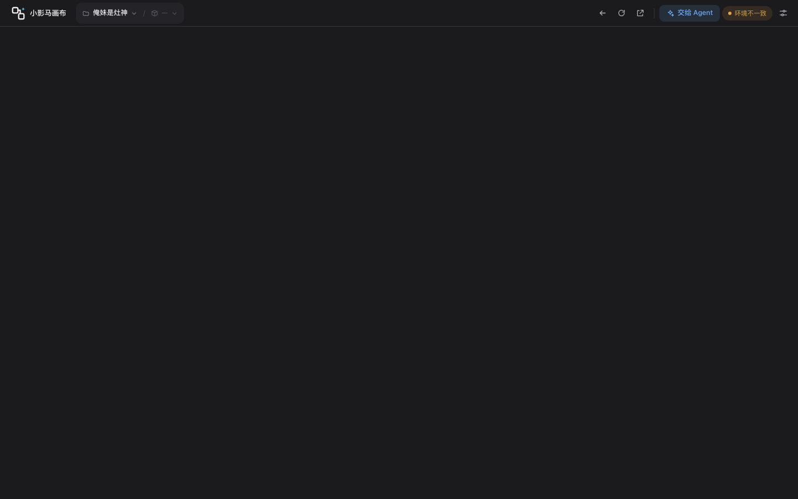
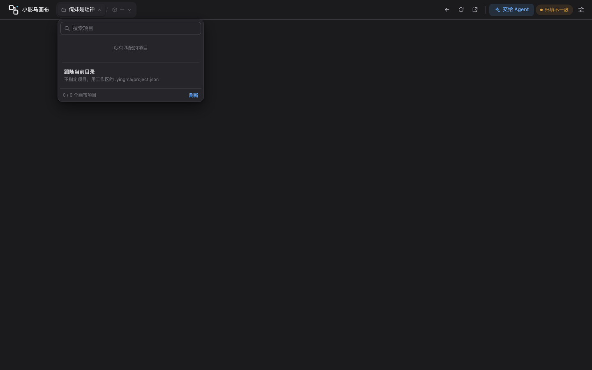
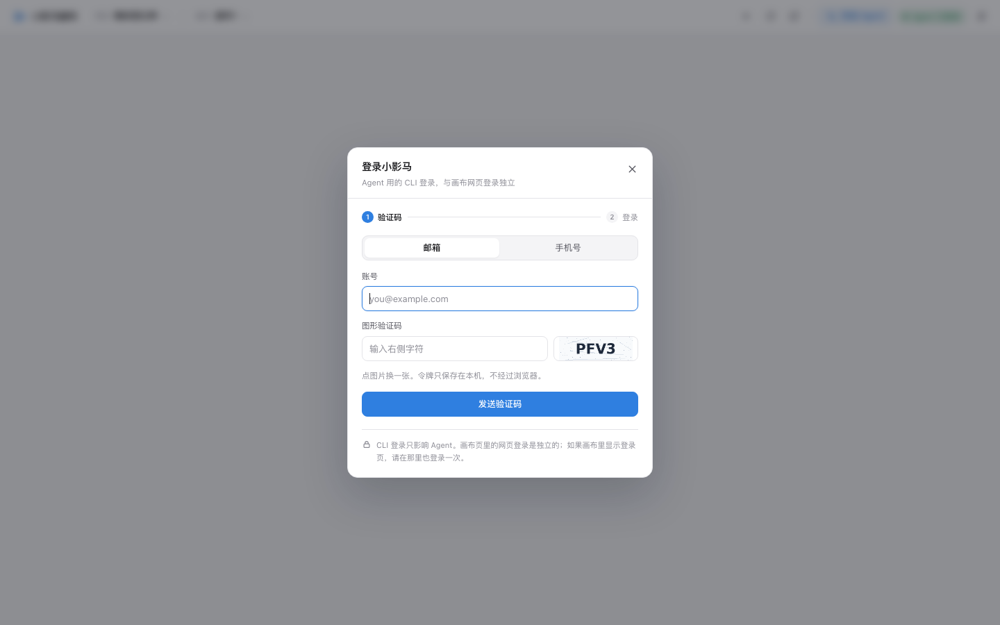

# dsh-yingma-canvas

小影马无限画布的 DeepSeek Harness 插件。



顶栏：项目 / 画布下拉（项目菜单带搜索）、回到画布、刷新、在影马打开、交给 Agent、登录态、设置。



## 功能

- 侧栏「小影马画布」：登录小影马、选画布项目/画布，在面板里打开影马自己的画布页（跨域 iframe，手动操作全保真）。
- Agent：`yingma_run` 工具在宿主进程执行 yingma CLI，读写画布节点、连线、生成任务；随包注册 `yingma-cli` skill。
- **项目解析**：`--project` 按「显式参数 > 侧栏选的项目 > 当前目录（含上级）`.yingma/project.json`」补齐；侧栏项目菜单里的「跟随当前目录」就是清空选择、交给目录绑定。目录绑定只读、插件从不写它，所以终端里 `yingma project use` 过的仓库能被沿用而不会被插件改写；显式参数和侧栏选择不一致时工具返回 warning，多项目来回切时不会静默打错项目。
- 登录：插件里走 CLI 的三步登录（图形验证码 → 邮箱/短信验证码），令牌只写入 `~/.yingma/config.json`，不经过浏览器。
- **免二次登录（P2）**：打开画布时 Host 向影马申请一次性登录码（`yingma auth handoff`，90 秒、只能用一次），iframe 加载 `/embed/canvas/{id}#code=…`；嵌入页兑换后把 token 存进自己的 localStorage，码从地址栏抹掉，不走 Referer。
- **软刷新（P2）**：Agent 改完画布，壳页给嵌入页发 `yingma:refresh-canvas`，画布拉一次增量合回；嵌入页回 `yingma:canvas-refreshed`，壳页收起「画布有更新」。
- 旧版兼容：影马还没部署 embed 时，`/api/embed` 自动退回普通画布页 + CLI 登录；没有软刷新时，更新提示保留，手动刷新。
- 版本：设置里显示插件 / CLI 随包 / CLI 系统的版本；「检查更新」对比 npm 上的插件版本和仓库/系统里的 CLI 版本。




## 画布放在对话旁边（DSH 0.2 起）

插件把画布注册成 DSH 右侧停靠栏的一个标签页（类型 `yingma-canvas`）：对话在中间，画布在右边，可以拖宽、全屏或浮成独立窗口。

- 主面板里的画布点「Agent 对话」「添加到Chat」「交给 Agent」：开一个新会话，并自动把画布标签页放到这个会话右边。
- 已经停靠在会话旁边的画布再点这些入口：草稿直接插进旁边这个会话的输入框，不另开会话（插不进去时退回开新会话）。
- 也可以在停靠栏的「+」引导页里选「小影马画布」手动打开。
- 老版本 DSH 没有右侧停靠栏时，只保留侧栏入口，行为和以前一样。

## 小影马工具（MCP）

插件通过 `cordis.patch.yml` 自动接入 `yingma mcp`（`@deepseek-ai/dsh-mcp-client`，stdio）。Agent 会看到 `mcp__yingma__*` 工具，按当前项目类型提供画布 / 流水线 / 互动影游工具：

- 写之前必须先读（防止覆盖别人刚改的内容）；写操作返回 `op_id`，可用 `undo` 撤销。
- 删除、扣费类操作进入「待确认」，在小影马页面右下角的卡片上确认后才执行；Agent 用 `action_status` 查结果。
- 工具跟着侧栏选的项目走，也可以用 `yingma_project_use` 切换。

同一个命令也能接到别的 Agent：`claude mcp add yingma -- yingma mcp`。

设置里「画布里的 Agent」默认是 DeepSeek Harness：画布上的「画布助手」「加入对话」会在 DSH 里开新对话并带上选中的节点；可以切回小影马自带的画布助手。

## 使用

1. 侧栏点「小影马画布」。
2. 顶栏显示的是 **Agent 的 CLI 登录态**；未登录时点「Agent 未登录」，插件会在浏览器打开小影马授权页（`/cli/authorize`），用任意方式登录、核对确认码后点「授权」即可。画布页用同一个令牌换一次性码自动登录，不用再登一次。
3. 选项目（只列画布项目）、选画布，画布在面板里打开。
4. 让 Agent 操作画布：在对话里说「用 yingma 读一下当前画布」，或点壳页顶栏的「交给 Agent」。
5. Agent 改完画布：embed 生效时自动软刷新；否则点「刷新」。
6. 在画布 iframe 里点链接跳到了别的影马页面：点顶栏「回到画布」就回来（embed 生效后，这类链接会改成新标签打开）。
7. 退出 Agent 登录：设置 → Agent 登录 → 退出登录。它只清 CLI 令牌，不会清画布里的网页登录；画布网页登录请用画布页自己的退出。

> CLI 登录只影响 Agent。embed 生效后，打开画布不再需要网页登录；embed 没部署时，画布页里仍可能要单独登录一次。

## 结构

```
lib/index.js    Host：skill provider、yingma_run、/yingma-canvas/ 路由、/api/embed 登录码
lib/cli.js      node 解析、CLI 串行执行、读写判断、项目注入、auth handoff
lib/tools.js    yingma_run 工具（--yes 必须配 confirm:true；文件参数只能在会话目录里）
lib/skills.js   把随包的 skills/yingma-cli 注册进 DSH
lib/store.js    $DSH_HOME/yingma-canvas/state.json（项目、画布地址、最近改动）
lib/client.js   侧栏入口 + main 面板 + 同源壳页 iframe
web/            壳页（原生 HTML/CSS/JS）：顶栏、项目/画布、登录向导、设置、软刷新协议
skills/yingma-cli/   CLI 脚本 + 命令参考（随包快照；含 yingma mcp）
test/           node --test：参数解析、文件路径限制、接口安全、MCP 协议
```

## 影马侧改动（P2）

| 位置 | 改动 |
| --- | --- |
| `backend/services/auth_handoff.py` | 一次性登录码：Redis 只存 sha256 摘要，90 秒，兑换即删 |
| `backend/api/routes/auth.py` | `POST /api/auth/embed/handoff`（需登录）、`POST /api/auth/embed/redeem`（公开） |
| `backend/middleware/auth.py` | `redeem` 加进公开名单（码本身即凭证） |
| `frontend/src/app/embed/canvas/[id]/page.tsx` | 兑换码、存 token、抹 hash、渲染画布、接软刷新协议 |
| `frontend/src/features/projectCanvas/components/ProjectCanvasPage.tsx` | 监听 `yingma:canvas-refresh`，拉增量合回后回 `yingma:canvas-refreshed` |
| `frontend/next.config.ts` | `/embed/:path*` 加 `Referrer-Policy: no-referrer`、`X-Robots-Tag: noindex` |
| `skills/yingma-cli/scripts/yingma.js` | 新增 `yingma auth handoff` |

## 上线顺序

1. **先发前端**：`/embed/canvas` 页面、画布页的刷新监听、next.config 的头。
2. **再发后端**：两个 embed 接口。

反过来会有一个窗口：接口有了、页面还没上，`/api/embed` 会返回 embed 地址但 iframe 404。当前插件在接口 404 时会回退，但接口成功而页面缺失时没有跨域探测。

## 已验证

- 单测：`test_auth_handoff.py` 5 条（一次性、坏码、字节值、多码隔离、截断码）；`test_auth_embed_routes.py` 3 条（handoff → redeem、重复兑换 401、未登录 401）。
- `tsc --noEmit` 通过；Next dev 的 `/embed/canvas/...` 返回 200，带 `Referrer-Policy: no-referrer` / `X-Robots-Tag`。
- 嵌入页失败态（坏码/未登录）在无头 Chrome 里渲染正常。
- 插件 `/api/embed` 在 production API 还没有 handoff 接口时正确回落（`fallback: true`），壳页 iframe 用普通画布 URL。
- 插件 reload 后 `/api/status` 仍正常（CLI 0.5.3、已登录）。

## 已知边界

- 软刷新要影马前端部署后才生效；现在生产上仍是「更新提示 + 手动刷新」。
- embed 没上线前，网页登录和 CLI 登录仍是两套。
- token 存在 iframe 的 localStorage（浏览器分区），不进 DSH 页面；插件不读取 `~/.yingma/config.json`。
- 测试环境：壳页设置里改画布地址；CLI 的 API 地址用环境变量 `YINGMA_API_BASE`。
- DSH 桌面版折叠左栏时，主面板会伸到窗口左上角；壳页会给 macOS 的窗口按钮预留左侧安全区（按 iframe 在父页面里的位置计算，浏览器版/Windows 不预留）。
